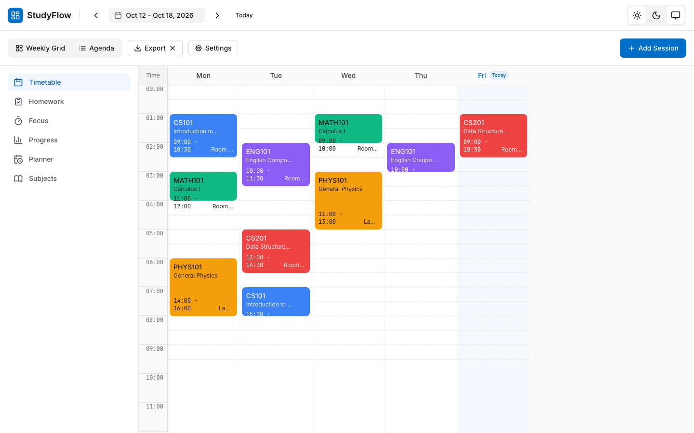
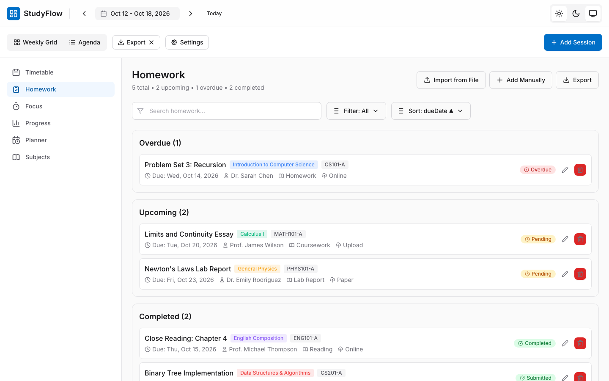
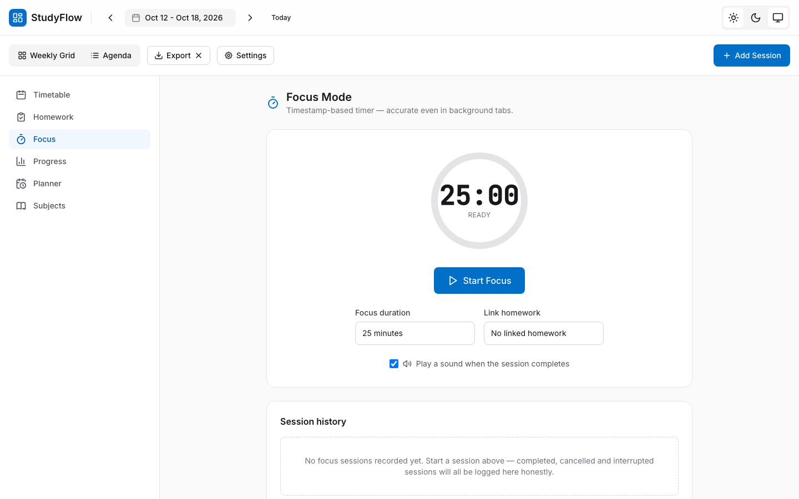
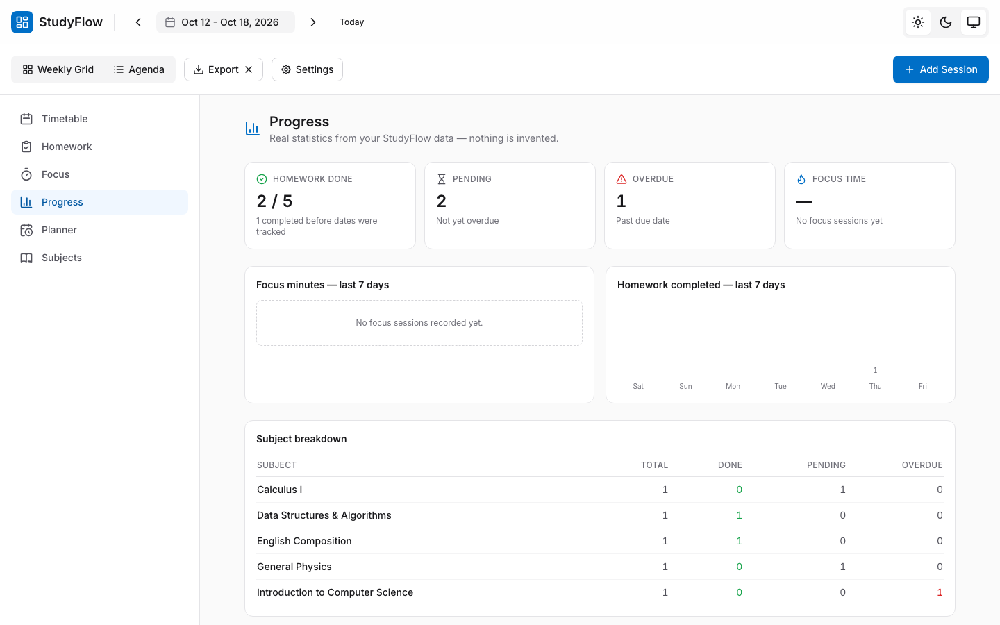
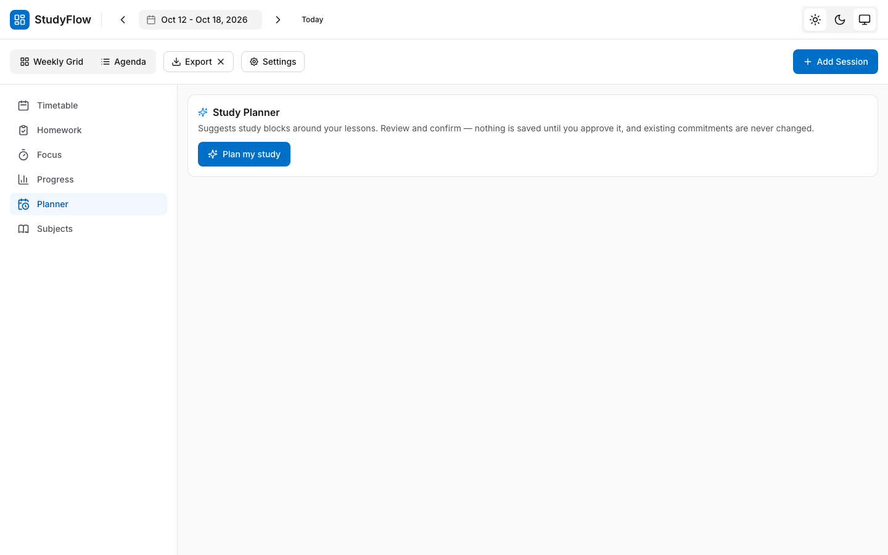
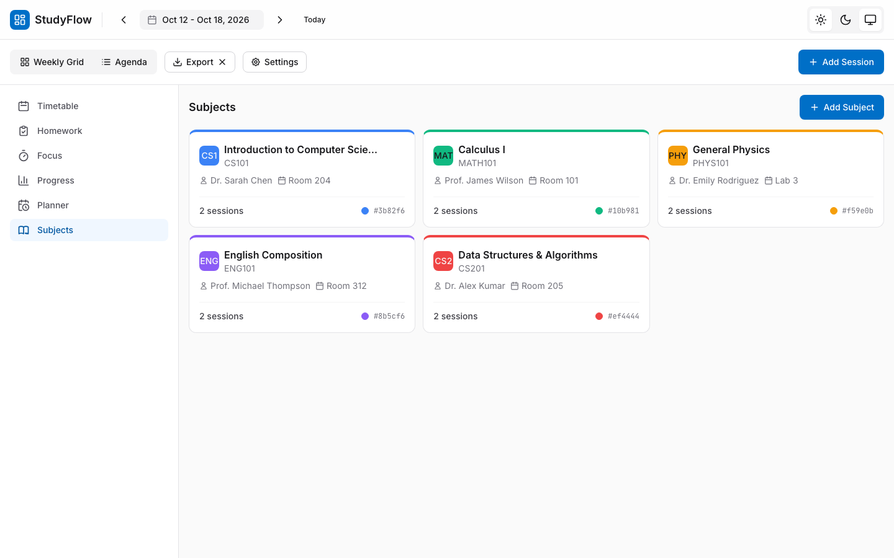
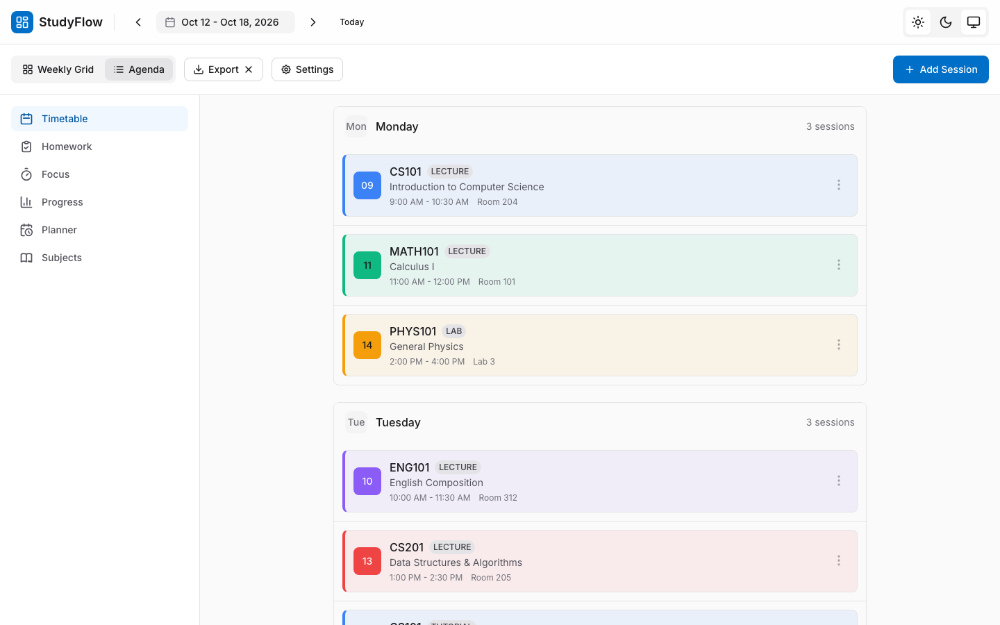

# StudyFlow

**Student Timetable & Study Planner**

StudyFlow is a local-first student timetable and study-planning application built
with React, TypeScript, and Vite. Manage your weekly timetable, track homework
deadlines, run focused study sessions, and review your progress — all running
entirely in your browser, with no accounts, no cloud sync, and no data leaving
your machine.

[](https://github.com/sarveshaug21-cyber/studyflow-timetable/actions/workflows/ci.yml)
[🔗 View on GitHub](https://github.com/sarveshaug21-cyber/studyflow-timetable)

## Screenshots

<table>
  <tr>
    <td><b>Weekly Timetable</b></td>
    <td><b>Homework Tracker</b></td>
  </tr>
  <tr>
    <td></td>
    <td></td>
  </tr>
  <tr>
    <td><b>Focus Mode</b></td>
    <td><b>Progress Dashboard</b></td>
  </tr>
  <tr>
    <td></td>
    <td></td>
  </tr>
  <tr>
    <td><b>Study Planner</b></td>
    <td><b>Subject Manager</b></td>
  </tr>
  <tr>
    <td></td>
    <td></td>
  </tr>
  <tr>
    <td><b>Agenda View</b></td>
    <td></td>
  </tr>
  <tr>
    <td></td>
    <td></td>
  </tr>
</table>

All screenshots are genuine captures of the running application with
demonstration data.

## Features

- **Weekly timetable & agenda views** — drag-free, keyboard-friendly session
  placement on a time-axis grid with current-time indicator.
- **Subject management** — create and organise subjects with colour codes,
  instructors, and room locations.
- **Homework tracking** — create, edit, filter, sort, search, and export
  homework with priority, study estimates, due dates, and status
  (pending / submitted / completed / overdue).
- **Focus Mode** — timestamp-based Pomodoro-style timer with pause/resume,
  homework linkage, and session history that feeds into progress statistics.
- **Progress Dashboard** — real statistics computed from your stored homework,
  timetable, and focus-session data (nothing is invented).
- **Smart Study Planner** — suggests study blocks around your existing
  commitments. Nothing is saved until you approve it; accepted blocks become
  one-off timetable sessions and existing commitments are never overwritten.
- **Local file import** — bring homework in from `.csv` or `.json` files with
  validation, duplicate detection, preview, and merge behaviour
  (see `docs/IMPORT.md`).
- **JSON export** — download a backup of your homework data at any time.
- **Settings** — theme (light / dark / system), time increment, week boundaries,
  daily time range, focus duration, and more.
- **Data persistence** — your timetable, homework, sessions, and focus history
  are saved to your browser's `localStorage` and restored on reload.

## Technology stack

- **React 18** — UI library
- **TypeScript** — type safety
- **Vite** — build tool and dev server
- **Tailwind CSS** — styling
- **date-fns** — date utilities
- **lucide-react** — icons
- **@dnd-kit** — drag-and-drop interactions
- **html2canvas** + **ics** — export capabilities
- **Vitest** + **Testing Library** — unit and component testing (298 tests)
- **ESLint** — linting
- **Playwright** — browser automation

## Prerequisites

- Node.js 18 or later
- npm

## Installation

```bash
# Clone the repository
git clone https://github.com/sarveshaug21-cyber/studyflow-timetable.git
cd studyflow-timetable

# Install dependencies
npm install
```

## Available commands

| Command | Description |
|---------|-------------|
| `npm run dev` | Start the development server (http://localhost:3000) |
| `npm run build` | Type-check and build for production |
| `npm run preview` | Preview the production build locally |
| `npm run typecheck` | Run TypeScript type-check (`tsc --noEmit`) |
| `npm test` | Run the full Vitest test suite |
| `npm run lint` | Run ESLint (0 errors; 8 pre-existing warnings ≤ 10 gate) |

## Architecture

```
src/
  components/        # UI components (timetable, homework, focus, planner, etc.)
  components/homework/   HomeworkView, HomeworkEditor, ImportDialog
  components/planner/    StudyPlanner (suggest-only review workflow)
  components/focus/      FocusMode (timer + session history)
  components/progress/   ProgressDashboard
  components/timetable/  TimetableGrid, DayColumn, TimeAxis, SessionBlock
  components/subjects/   SubjectManager, SubjectFormModal, SubjectCard
  components/layout/     Header, Toolbar, SettingsPanel, ExportMenu
  components/ui/         Reusable primitives (Button, Input, Modal, Dropdown, ...)
  context/               React context providers (Timetable, Focus, Settings, Theme)
  context/timetableStorage.ts   Pure serialise/revive/normalise helpers
  hooks/                 Custom hooks (useTimetable, useStudyPlanner, useFocus, ...)
  types/                 TypeScript types and domain helpers
  utils/                 Scheduler, progress stats, export, CSV/JSON import
  test/                  Test fixtures and setup
```

The scheduling engine is **pure and deterministic**: it only *suggests* study
blocks and never mutates your timetable. Nothing is saved until you explicitly
approve it, and existing commitments are never overwritten.

## Data persistence and privacy

StudyFlow is **local-first and client-side only**:

- All data (timetable, subjects, sessions, homework, focus history, settings)
  is stored in your browser's `localStorage` under the key
  `studyflow-timetable`.
- Data is restored automatically when you reload the page.
- Nothing is transmitted to any server. There are no accounts, no telemetry,
  no analytics, and no background uploads.
- Browser data is **not** shared across devices or browsers — it lives only in
  the browser where it was created. Use the **Export** button in the Homework
  view to download a JSON backup, and re-import it to restore.

The storage layer is defensive: malformed or foreign JSON is treated as empty
and is never written back over your stored value. Valid data is always
preserved.

## Homework and deadlines

- Create homework with title, subject, teacher, group, type, due date, status,
  priority, study estimate, and optional description.
- Filter by All / Upcoming / Overdue / Completed, sort by due date or subject,
  and search by title, subject, or teacher.
- Export filtered homework to JSON.
- Edit or delete homework at any time; completion timestamps are tracked
  automatically.

### Importing homework

Use **Import from File** in the Homework view to bring homework in from a local
`.csv` or `.json` file. Records are validated, previewed, checked for likely
duplicates, and merged into your existing list — nothing is overwritten. See
`docs/IMPORT.md` for the full specification and sample files.

### VLE integration

StudyFlow does **not** have a live VLE (virtual learning environment) integration.
A connector design exists as a documented, not-implemented interface (browser
extension reading the authenticated portal via `postMessage`), but it requires
authenticated access that is not available. Homework import is instead provided
through the local file-import workflow described above. No school credentials,
cookies, or private data are ever requested or stored.

## Accessibility and responsive design

- Keyboard-navigable sidebar and modal dialogs with focus management.
- ARIA labels on buttons, status badges, and form controls.
- `role="timer"` with `aria-live="polite"` on the Focus Mode countdown.
- Dark mode support (light / dark / system theme).
- Responsive layout: collapsible sidebar on mobile, adaptive grids and tables.
- Colour contrast designed for readability in both light and dark themes.

## Known limitations

- **Local-only storage:** Data lives in `localStorage` and is not synced across
  devices. Export your data regularly for backups.
- **`localStorage` limits:** Browsers typically cap `localStorage` at ~5–10 MB;
  very large timetables may exceed this.
- **No live VLE integration:** The connector is a design document only;
  homework import is via local CSV/JSON files.
- **No user accounts or sharing:** Data is private to your browser profile.

## Roadmap

- Focus session breaks between consecutive focus blocks
- Homework recurrence and reminders
- Calendar export (iCal/Google) using the existing `ics` dependency
- Virtualisation for large timetable and homework lists

## Repository

🔗 https://github.com/sarveshaug21-cyber/studyflow-timetable

## License

MIT License — see [LICENSE](LICENSE) for details.
